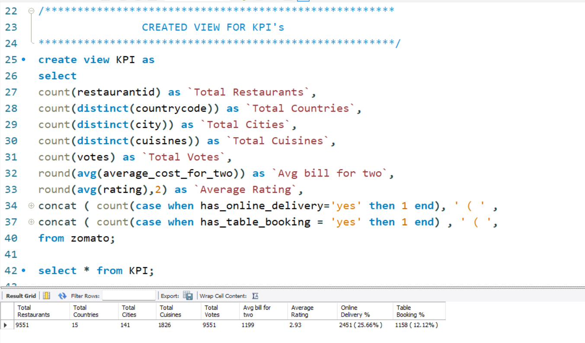
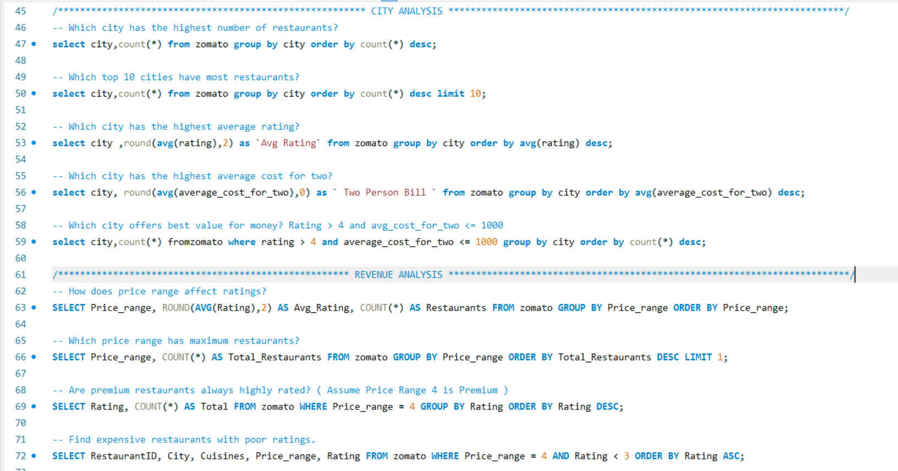
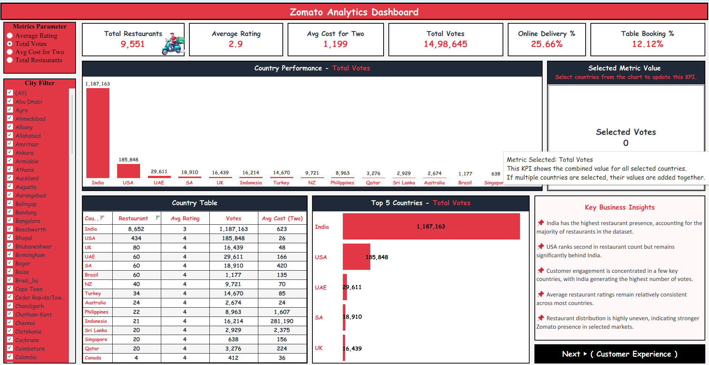
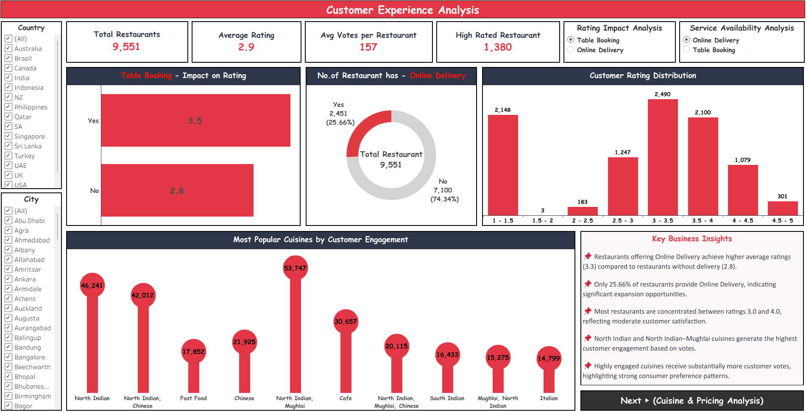
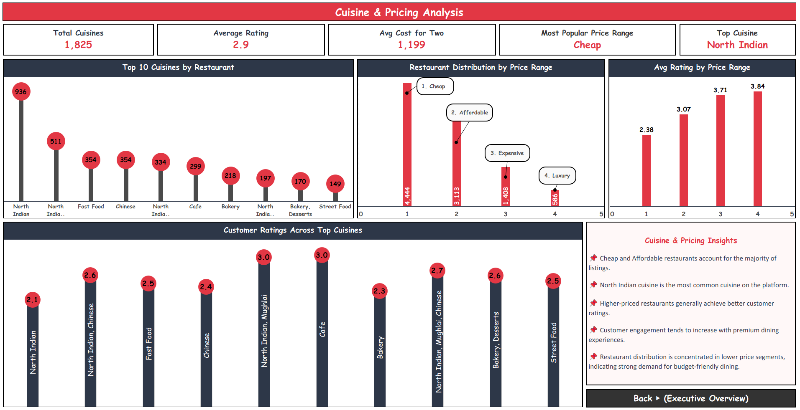

# Zomato Restaurant Performance & Customer Rating Analytics

[](#)
[](#)
[](#)
[](#)

**Author:** [Arya Pandey](https://github.com/aryapandeyyy28-sudo)  
**Role:** Data & Business Analyst  
**Contact:** [aryapandeyyy28@gmail.com](mailto:aryapandeyyy28@gmail.com)

---

## Business Overview
An end-to-end data analytics study of Zomato dining establishments, pricing dynamics, online delivery efficiency, and customer rating distributions. This project combines SQL extraction with interactive Tableau and Power BI visual dashboards to uncover the core operational drivers behind customer retention, high review scores, and average dining spend.

---

## Key Business Questions Analyzed
- What is the statistical correlation between average dining cost for two and aggregate customer rating?
- How significantly does enabling online ordering or table reservation affect total vote engagement?
- Which city territories and micro-markets present high demand with underserved restaurant presence?
- What are the dominant cuisine distributions across budget, mid-range, and luxury price bands?

---

## Dashboard Visuals & Analytical Reports

### 1. Executive Performance Overview
> Primary executive scorecard displaying key metrics across total restaurants, aggregate rating distributions, average spend for two, and total voter engagement.


---

### 2. Rating Breakdown by Cost Tier
> Evaluates customer satisfaction scores and rating counts segmented across dining price tiers.



---

### 3. Online Delivery vs. Dine-In Performance
> Comparative distribution examining operational differences, vote volume, and ratings between delivery-enabled and dine-in venues.


---

### 4. Table Booking Impact Analysis
> Evaluates customer sentiment and booking adoption rates for fine-dining versus casual establishments.


---

### 5. City & Locality Market Density
> Geographic distribution mapping restaurant density, territory-level average costs, and local rating benchmarks.



---

### 6. Cuisine Popularity & Voter Segmentations
> Comprehensive matrix detailing top cuisine categories, cost distribution, and vote concentrations.


---

### 7. Strategic Operational Drill-Downs

#### Customer Engagement & Review Distribution


#### Cost for Two vs. Rating Dispersion


#### High-Demand Locality Matrix


---

## Data Pipeline & Modeling

### 1. Ingestion & Preprocessing (SQL & Excel)
- Extracted and normalized raw restaurant records, addressing missing values in pricing and ratings.
- Deconstructed and parsed multi-value cuisine strings into clean categorical dimensions.
- Created price tier categorizations (Budget, Moderate, Premium) using conditional SQL logic.

### 2. Analytical Queries & Measures
- Formulated vote-weighted average ratings to prevent statistical distortion from low-sample outlets.
- Calculated rating distributions and order-channel shares across geographic zones.
- Designed dynamic aggregations to benchmark outlet performance against local territory medians.

---

## Key Analytical Insights
- **Online Delivery Lift:** Outlets offering active online food delivery observed significantly higher voter volume and stable sentiment ratings.
- **Cost-to-Value Sweet Spot:** Mid-tier establishments (Average Cost for Two between 500 and 1,200) achieved the highest balance of customer ratings and repeat review counts.
- **Reservation Advantage:** Establishments offering table reservations consistently sustained customer ratings above the 4.0 threshold.

---

## Repository Structure

```text
├── MySQL/              # Database transformation scripts and analytical SQL queries
├── Raw-Data/           # Source datasets (CSV / Excel)
├── Screenshots/        # Visual reports and dashboard captures
│   ├── Z1.png
│   ├── Z2.png
│   ├── Z3.png
│   ├── Z4.png
│   ├── Z5.png
│   ├── Z6.png
│   ├── Z_1.png
│   ├── Z-2.png
│   └── Z_3.png
├── Tableau/            # Tableau workbook files (.twbx)
└── README.md           # Business intelligence documentation
